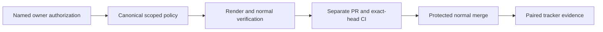

# Scoped agent readiness and merge authorization

In Resnovas/.github and Resnovas/Eventiva only, an agent may mark a PR ready and merge normally after all required checks are green. AI-assisted PRs still start as disclosed drafts. Other repositories keep the default human-owned readiness and merge restrictions.

Jonathan (@TGTGamer) approved this named AI-21/AI-31 exception on 2026-11-20, relayed through [Puck](https://ampcode.com/threads/T-01a1e940-37a3-7691-a5c0-e935b711c99a). The canonical rule is [AI-21](../AI_POLICY.md#ai-21), referenced by [AI-31](../AI_POLICY.md#ai-31). It grants no approval or self-approval, bypass, admin merge, force-push, sign-off, deployment or spending authority. Required reviews, branch protection, checks and the existing signing requirements remain in force. Record the named authorization and actual agent verification in the PR; never claim that an agent performed human review.

## Delivery timeline

Owner: [implementation worker](https://ampcode.com/threads/T-91eb2b98-52a8-404b-8a2b-2aec9ef35aca). Paired issue: [RES-71](https://linear.app/resnovas/issue/RES-71), [Resnovas/.github#67](https://github.com/Resnovas/.github/issues/67).

- Completed, 2026-11-20T13:03Z: read back the paired brief and current origin/main; retained the separate CodeQL packet without adopting unpublished work.
- Completed, 2026-11-20T13:05Z: canonical policy and directly conflicting guidance updated; render and agent-doc generation passed. `node --run verify:static` passed document budgets and six-interface registry coverage; `node --run verify` passed 105 tests, zero failures, 100% covered renderer-library lines and 98.57% branches on the local proposed tree. No check, permission or runtime code changed.
- Current: publish the separate normal PR with a mechanically refreshed clean-source graph and verify exact-head hosted CI.
- Upcoming: mark ready and merge only when configured required checks/reviews allow it, then synchronize tracker evidence. No downstream sync or deployment is part of this packet.

