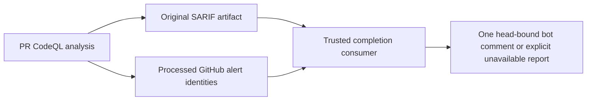

# CodeQL PR alert comment

RES-70 ([Linear](https://linear.app/resnovas/issue/RES-70), [GitHub #66](https://github.com/Resnovas/.github/issues/66)) adds one `github-actions[bot]` comment after **House CodeQL** finishes. It lists open alerts for the current PR merge ref: rule ID, security severity (or diagnostic severity), file:line, message and each original source-to-sink thread, in order. These are static-analysis paths, not runtime traces. Identical snapshots do not write another comment; newer snapshots update the owned comment.

## Evidence source and trust boundary

The [alert API](https://docs.github.com/en/rest/code-scanning/code-scanning#list-code-scanning-alerts-for-a-repository) supplies alert metadata, not complete paths. The [analysis SARIF download](https://docs.github.com/en/rest/code-scanning/code-scanning#get-a-code-scanning-analysis-for-a-repository) explicitly returns a subset and adds `github/alertNumber`. Never manufacture paths from message links or related locations.

The pinned [CodeQL analyzer contract](https://github.com/github/codeql-action/blob/33d7b85da1a04171e211befe2c739303b9a4c066/analyze/action.yml) exposes the original SARIF output directory and waits for processing by default. The existing analyzer now retains that original output as one artifact per language for seven days. The commenter matches its rule, message and physical location to the processed alert identity before reading its original `codeFlows`. A rule classified as `problem` without flows is explicitly not applicable, not a fabricated path.

The privileged `workflow_run` caller pins the reviewed house reusable-workflow implementation to a published default-branch commit SHA; its executable commenter module is checked out only from `Resnovas/.github@main`. It uses the ephemeral Actions `GITHUB_TOKEN`, with `security-events: read` and `pull-requests: write`; `actions: read` downloads analysis artifacts and `contents: read` checks out trusted house code. It does not use the connected App token, inherit repository secrets, check out a PR, restore PR caches or execute artifact content. The analysis job's existing permissions and scan semantics are unchanged. When changing reusable workflow logic, publish and review that implementation first, then update the caller pin to its reachable default-branch commit, not a pre-squash feature commit. Verify GitHub reports the pin as identical to or behind published main and compare the reviewed workflow blobs. Module-only fixes follow trusted main.

Every completion is reread through GitHub's API and bound to the repository, known workflow path, PR event, head repository and SHA. Every language job must have one processed analysis matching the PR merge ref, merge SHA and run time window. Artifact metadata must match run/repository/head and its SHA-256 archive digest. JSON and downloads are capped at 16 MiB; ZIP parsing permits at most 20 entries and 32 MiB expanded data, reads no extracted files and runs a fixed isolated Python standard-library reader with a ten-second timeout. Download redirects are limited to HTTPS Azure artifact storage and never receive the GitHub token. External strings are literal escaped comment text, never workflow expressions or script interpolation.

## Honest failures and retry

- Permission errors, failed/partial/missing analyses and pagination/result-count limits produce **results unavailable, not zero alerts**, and fail the commenter job.
- Missing, expired, mismatched or unsafe original artifacts retain alert metadata but explicitly report unavailable paths and fail the job. Rerun House CodeQL after the capture workflow is available on the default branch. Check the analysis and artifact before retrying the commenter.
- An oversized report says the one-comment size limit prevents a complete report. It does not silently drop alerts or claim completeness. Inspect code scanning and **Show paths** directly.
- A newer PR head or changed merge base rejects an old completion before writing. GitHub offers no conditional comment-write operation; a last-instant head race remains visible through the head/merge SHAs in the comment.
- A zero-alert report requires successful, processed, complete head-bound analysis. It is not evidence that an older alert was triaged or dismissed.

Fork analyses never receive repository secrets from this packet. The completion job has write permission but never loads fork executable code. Deployment of the completion trigger requires the workflow on the default branch; local tests do not exercise a hosted Actions token. Legacy runs without artifacts cannot yield complete original traces. This feature does not triage, dismiss or resolve alerts 64/65.

## Delivery timeline

| Date | State | Evidence / next step |
| --- | --- | --- |
| 2026-11-20 | Implemented locally | Source/API contract investigated; bounded original-SARIF parser and bot-comment contract tests cover creation, update, pagination, provenance, stale heads, unavailable data and injection. |
| 2026-11-20T13:31:30Z | Merged | [PR #69](https://github.com/Resnovas/.github/pull/69) merged as [c9d300a](https://github.com/Resnovas/.github/commit/c9d300a587bffd2de53b66339263e6e2ebbfbcd3). Local static/full gates passed 115 tests with zero failures; [six-platform CI](https://github.com/Resnovas/.github/actions/runs/44744368864), CodeQL, workflow lint, graph and [required smartcloud](https://github.com/Resnovas/.github/actions/runs/44744368903) passed on the final source head. The completion consumer and original-SARIF capture are now on house main. |
| 2026-11-20T13:34:38Z | Pin repair in progress | [Online zizmor](https://github.com/Resnovas/.github/actions/runs/44745481521/job/136319557413) rejected the pre-squash caller pin after PR #69 merged. [PR #72](https://github.com/Resnovas/.github/pull/72) pins the byte-identical reusable workflow at published main c9d300a and adds an ancestor-of-origin/main gate in the full-history test matrix. No permissions or runtime logic change. |
| Pending | Upcoming | Merge the pin repair only after normal checks pass, then observe a default-branch completion with its actual Actions token; report this separately from offline proof. No Eventiva sync or deployment is authorized. |

Owner and running record: [implementation thread](https://ampcode.com/threads/T-91eb2b98-52a8-404b-8a2b-2aec9ef35aca).

