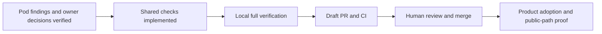

# Funnel implementation timeline

This changes contributor-visible verification order, pre-commit behavior and the shared AGENTS entry point. It does not authorize deployment, change artifact access or replace product gates.

Owner: [.github pod](https://ampcode.com/threads/T-01a1f637-2241-770e-aa29-22cf10bd727e). Task: [RES-67](https://linear.app/resnovas/issue/RES-67), [Resnovas/.github#55](https://github.com/Resnovas/.github/issues/55). Parent: [RES-66](https://linear.app/resnovas/issue/RES-66), [Resnovas/.github#54](https://github.com/Resnovas/.github/issues/54). SMC-175 and SMC-174 are superseded duplicates. Non-closing delivery until full acceptance.

## Completed discovery

- 2026-11-19T23:53Z: verified Eventiva and smartcloud findings; neither enables eslint-plugin-jsdoc. Preserve Eventiva's AST/rationale/zero gate and smartcloud's declaration/example contracts.
- 2026-11-19T23:53Z: GitHub counterparts created after open/closed duplicate searches. The integration assigned RES-66 and RES-67 (subsequently SMC-178) rather than attaching to the existing SMC issues. Mapping decision escalated; no issue deleted or relinked. The first Linear activity comment used an approximate future minute; this timeline records the actual observed tool timestamps.
- 2026-11-20T00:09Z: Jonathan approved ESLint as the minimal shared-config host, corrected AI-03 to prohibit delegated certification except the exact personal-instructions owner exception, and assigned canonical ownership to RES-66/RES-67. The existing author-email DCO check remains in smartcloud CI; its maintainer-warning and trusted-bot rules are unchanged.
- 2026-11-20T00:23Z: verified RES-67 restored to RES under RES-66 with GitHub #55 attached. Exact exception confirmed in loaded personal instructions; TGTGamer/private owner session verified. Updated RES-67 to In Progress for active local verification.

## Current local implementation

- Shared corrective source-inspection lint and additive JSDoc config; tests exercise rejected/accepted behavior, not deleted-source strings.
- Pre-commit preserves foreign hooks and requires matching staged/working trees, then static and full verification.
- Markdown registry parser, source-inventory comparison, affected selection and byte-bound evidence contracts. No schema result is claimed as semantic proof.
- Fixed document budgets, exact deployed build-info SHA check, static-first reusable CI and seven-day reviewed artifact publication policy.
- Shared AGENTS slimmed while retaining human authority, tracker lifecycle and tool-routing boundaries. Supplied escalation text retained verbatim.

## Verification and upcoming acceptance

2026-11-20T00:23Z: `npm ci --ignore-scripts` installed the locked toolchain with zero reported vulnerabilities. `node --run verify:static` passed document budgets and six-interface coverage. `node --run verify` passed render, 19 headers, surfaces, generated docs and 103 tests, with measured renderer coverage of 100% lines and 98.58% branches. `node --run verify:evidence` executed all nine documented contracts; `node --run verify:evidence:check` reported structurally valid, byte-bound publication evidence. The installed pre-commit hook is exercised in disposable Git repositories. No downstream runtime, production endpoint or media-redaction review is claimed by these nonvisual contracts.

1. Retain the staged-tree evidence and final full-check results through delivery.
2. Refresh the code graph from clean sources and preserve it as a separate task commit.
3. Push a disclosed draft PR with linked issue references; human owns readiness and merge.
4. Product pods adopt the tested shared contracts via normal house sync; preserve their trust gates, coverage and documentation ratchets. Verify affected runtime/native paths in those repositories.

