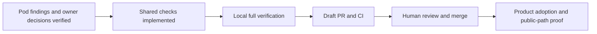

# Funnel implementation timeline

This changes contributor-visible verification order, pre-commit behavior and the shared AGENTS entry point. It does not authorize deployment, change artifact access or replace product gates.

Owner: [.github pod](https://ampcode.com/threads/T-01a1f637-2241-770e-aa29-22cf10bd727e). Task: [RES-67](https://linear.app/resnovas/issue/RES-67), [Resnovas/.github#55](https://github.com/Resnovas/.github/issues/55). Parent: [RES-66](https://linear.app/resnovas/issue/RES-66), [Resnovas/.github#54](https://github.com/Resnovas/.github/issues/54). SMC-175 and SMC-174 are superseded duplicates. Non-closing delivery until full acceptance.

## Completed discovery

- 2026-11-19T23:53Z: verified Eventiva and smartcloud findings; neither enables eslint-plugin-jsdoc. Preserve Eventiva's AST/rationale/zero gate and smartcloud's declaration/example contracts.
- 2026-11-19T23:53Z: GitHub counterparts created after open/closed duplicate searches. The integration assigned RES-66 and RES-67 (subsequently SMC-178) rather than attaching to the existing SMC issues. Mapping decision escalated; no issue deleted or relinked. The first Linear activity comment used an approximate future minute; this timeline records the actual observed tool timestamps.
- 2026-11-20T00:09Z: Jonathan approved ESLint as the minimal shared-config host, corrected AI-03 to prohibit delegated certification except the exact personal-instructions owner exception, and assigned canonical ownership to RES-66/RES-67. The existing author-email DCO check remains in smartcloud CI; its maintainer-warning and trusted-bot rules are unchanged.
- 2026-11-20T00:23Z: verified RES-67 restored to RES under RES-66 with GitHub #55 attached. Exact exception confirmed in loaded personal instructions; TGTGamer/private owner session verified. Updated RES-67 to In Progress for active local verification.

## Implemented contracts

- Shared corrective source-inspection lint and additive JSDoc config; tests exercise rejected/accepted behavior, not deleted-source strings.
- Pre-commit preserves foreign hooks and matching staged/working trees. The scope correction below replaces its original full verification with affected tests.
- Markdown registry parser, source-inventory comparison, affected selection and byte-bound evidence contracts. No schema result is claimed as semantic proof.
- Fixed document budgets, exact deployed build-info SHA check, static-first reusable CI and seven-day reviewed artifact publication policy.
- Shared AGENTS slimmed while retaining human authority, tracker lifecycle and tool-routing boundaries. Supplied escalation text retained verbatim.

## Delivery and verification

2026-11-20T00:23Z: locked install reported zero vulnerabilities. `verify:static` and `verify` passed six-interface coverage and 103 tests (renderer 100% lines/98.58% branches). Nine documented evidence contracts passed byte-bound validation; disposable repositories exercised hooks. These are nonvisual tooling proofs, not downstream runtime or production evidence.

- 2026-11-20T00:26Z: opened [#56](https://github.com/Resnovas/.github/pull/56) as draft. Linear converted it; later owner decisions below supersede restoration.
- 2026-11-20T00:28Z: [six-lane CI 44645981211](https://github.com/Resnovas/.github/actions/runs/44645981211) passed, but dependency review rejected three licences and CodeQL found hook-write/evidence-read races.
- 2026-11-20T00:34Z: fixed races with exclusive hook creation and single-descriptor evidence reads. Static gates and 103 tests passed, covering 18 JSDoc rule pairs and 12 declaration shapes. Retained downstream AST/example gates and semantic guidance.
- 2026-11-20T00:37Z: verified MIT-only parse-statements@1.0.11 provenance. Held approved exact-version exceptions for it, spdx-exceptions@2.5.0 and uri-js@4.4.1 after finding dependency-review-action v5 ignores versions; did not broaden them without approval.
- 2026-11-20T00:41Z: approved sentence-form/example rules brought coverage to 20 fixture pairs. Eventiva adoption remained separate, including registry/media and inventory-fallback work.
- 2026-11-20T00:45Z: Jonathan approved all versions of exactly those three packages, without a version guard. [#57](https://github.com/Resnovas/.github/pull/57) passed 93 tests; prerequisite policy-first merge and base-ref enforcement remained intact.
- 2026-11-20T00:48Z: [Linear docs](https://linear.app/docs/code-and-reviews) and timelines linked Copilot review requests to ready conversions on #56/#57. No personal settings changed.
- 2026-11-20T00:49Z: #57 CI passed; #56 passed 104 local tests with unchanged coverage.
- 2026-11-20T00:54Z: [#56 head afa5fb1](https://github.com/Resnovas/.github/commit/afa5fb16e5b2e222e7067c3738a086b12e448f6c) passed [six-lane CI 44649187620](https://github.com/Resnovas/.github/actions/runs/44649187620), CodeQL/lint/graph; evidence expires November 27. Only unmerged licence policy blocked required aggregation. Verified drafts and tracker mirrors; handed off prerequisites.
- 2026-11-20T01:05Z: Jonathan merged #57 at 01:03:41Z. A push lease preserved his concurrent [#56 merge 1697fab](https://github.com/Resnovas/.github/commit/1697fab935d1b7271a4e8b81640532980d624f23); retained the unpublished rebase backup. [CI 44650896227](https://github.com/Resnovas/.github/actions/runs/44650896227), dependency review and smartcloud passed without rewriting his work.
- 2026-11-20T01:18Z: Jonathan merged #56 as [6cabf3a](https://github.com/Resnovas/.github/commit/6cabf3afd23652fe1816c81bc1041ab2bf4b000f). [Main CI](https://github.com/Resnovas/.github/actions/runs/44652409049) and all seven other workflows passed; downstream adoption remained open.
- 2026-11-20T01:23Z: resumed for Eventiva's 3,303,046-byte inventory overflow, generated prose overcount and smartcloud canonical-header conflict. No product gate relaxation.
- 2026-11-20T01:29Z: reproduced ENOBUFS with 18,000 indexed files, header failures and generated-region overflow (504/400 lines). Fixed controls still reject authored overflow, malformed markers and undocumented declarations.
- 2026-11-20T01:32Z: static/full checks passed 104 tests at 100% lines/98.58% branches. Scoped inventory before buffering, omitted only balanced generator regions and exempted exact canonical headers in two prose rules. No dependency/exclusion changes; downstream proof remained separate.
- 2026-11-20T06:26Z: review host marked [#60](https://github.com/Resnovas/.github/pull/60) ready and requested forward reconciliation of accepted [#61](https://github.com/Resnovas/.github/pull/61). Preserved both Verify templates, regressions and adoption repairs; regenerated LLMS/graph without force push or policy changes.
- 2026-11-20T10:08:24Z: TGTGamer merged #60 as [db0d996](https://github.com/Resnovas/.github/commit/db0d996da8e7c5e77f4664f0a54de03bd5dfa469), matching reviewed [d8cd965](https://github.com/Resnovas/.github/commit/d8cd9655c9c3809dc211c21dfd7d7747f244466c): 105 local tests, nine evidence contracts and six-lane PR checks passed. Both pods received accepted source; main macOS lanes remained pending. No queue-policy or downstream acceptance implied.
- 2026-11-20T10:12Z: smartcloud's package-local Nx lint exposed a new header-path defect: `context.cwd` made the adapter read a package-local licence template and compare package-relative identity. Root/nested-cwd fixtures reproduce ENOENT before the fix and pass with repository/template identity anchored to the synced module location. Retain canonical/noncanonical, wrong-path/year and declaration controls. Work is active on `agents/res-67-license-root`; full gates and a correction PR precede any accepted-revision claim.
- 2026-11-20T10:14:27Z: #60 main CI completed all six OS/Node lanes, rendered and aggregate check successfully. CodeQL, smartcloud, lint, Scorecard and graph refresh also passed. Merged-main verification is complete, distinct from downstream adoption and the unresolved merge-group policy hold.
- 2026-11-20T11:10:18Z: Jonathan merged the nested-cwd correction [#62](https://github.com/Resnovas/.github/pull/62) as [92bb0b9](https://github.com/Resnovas/.github/commit/92bb0b9d06e95d88395d158e35c5aaf1b9e65004). [Main CI 44725380321](https://github.com/Resnovas/.github/actions/runs/44725380321) passed; accepted-source handoff went directly to smartcloud and Eventiva. Eventiva's isolated 65.4.5 compatibility probe is not full adoption.
- 2026-11-20T11:14Z: Jonathan extended exact-header exemption to all shared JSDoc rules and Node consumers. Reproduced sentence/tag-preference failures; delegated vendor rules through the existing adapter, retaining both aliases. Twenty fixture pairs and rendered Eventiva/smartcloud/Node controls pass at root/nested cwd while rejecting wrong headers and missing docs. No readiness or queue-policy changes.
- 2026-11-20T11:17Z: static/full verification passed 106 tests (100% lines/98.57% branches), ten byte-bound contracts and an audit of all 78 vendor rules. Declaration, invalid-settings and whole-file controls remained active; downstream adoption was not claimed.
- 2026-11-20T11:24:40Z: the separate all-rule exact-header extension [#63](https://github.com/Resnovas/.github/pull/63) is published, not accepted. Local 106 tests and ten evidence contracts pass; hosted six-lane CI, CodeQL, lint, dependency review and Graphify pass. Linear converted the draft and the unchanged restoration job failed for missing permission; smartcloud aggregates that failure. Leave drafts/settings/tokens unchanged per Jonathan. The extension is not included in the separate policy-only branch.
- 2026-11-20T11:37:18Z: resumed RES-67 for Puck's shared licence-policy rollout request. Regression reproduced the missing exceptions in rendered downstream policy. Move exactly the three all-version exceptions approved in #57 from local house policy into its managed template; retain the licence allowlist and vulnerability/base-ref checks. Document policy-first adoption and reviewed duplicate-local-key migration. No dependency, workflow, access or merge-group-policy change.
- 2026-11-20T11:40Z: the policy-only branch passes static verification and all 106 tests, with renderer coverage of 100% lines and 98.59% branches. The new rendering regression fails before the template change and passes after; it proves the exact package scope, preserved licence allowlist, duplicate-key rejection, unrelated local policy preservation and idempotent migration. Human acceptance and downstream policy-first rollout remain pending; this is not JSDoc adoption evidence.

## Remaining acceptance

1. Deliver and accept the separate optional React lint set, then verify Eventiva's replacement of its local rules. #63, #64 and #65 are accepted; consuming repositories must land shared licence policy before dependency adoption. Runtime aggregation and queued-SHA proof remain separate gates.
2. Re-run downstream discovered-config and document-budget checks against the accepted revision. Eventiva's unmarked over-budget documents remain downstream remediation, not exemption candidates; no JSDoc installation or complete adoption is claimed there.
3. Product pods adopt the tested shared contracts via normal house sync; preserve their trust gates, coverage and documentation ratchets. Verify affected runtime/native paths in those repositories. A synced config is not proof of adoption.
4. RES-67 and RES-66 remain non-closing until whole-issue acceptance. Do not remove the personal documentation paragraph until downstream adoption is verified; the remaining semantic guidance now lives in shared AGENTS and the canonical guide.

## EVE-261 process-lifetime follow-up

- 2026-11-20: [PR74](https://github.com/Resnovas/.github/pull/74) merged14:09:10Z; accepted core synced.
- 2026-11-20T15:10:00Z: TGTGamer merged [nesting PR75](https://github.com/Resnovas/.github/pull/75), exact5769778, as608ab6f; all six lanes green. No human review was invented. Downstream sync remains separate.
- 2026-11-20T16:30Z: [native B](test-process-security.md#windows-native-acquisition) PR78 fbcf270: Windows151/153 and147/153; four POSIX lanes green. Early700ms readiness fails; numeric creation/Main/connect/decode diagnosis follows. No warm-up/budget change. Alerts70/71, queue/merge/adoption remain held; EVE-261 open.

- 2026-11-20T13:55:16Z: PR59 merged as [d6daf4a](https://github.com/Resnovas/.github/commit/d6daf4af54bf195915d14ac04706aa5ea4ba3152), green sourcecd1dc80. Eventiva sync exposed missing actual-close evidence. Puck approved the close-only follow-up: three red cases, then21/21/static green, unchanged lifetime/budgets. [Proof](test-process-security.md#explicit-descriptor-close-evidence); hooks/matrix/resync were pending.

- 2026-11-20T06:30Z: [replacement owner](https://ampcode.com/threads/T-5dcbf3b4-41e4-4df0-906d-93629eebe199) reproduced the [PR59](https://github.com/Resnovas/.github/pull/59) descendant defect against `ed465c31`: deadline 154 ms, direct exit 156 ms, actual close 1868 ms for a 150 ms budget. Five additional real resistant-descendant contracts fail on that baseline: deadline, cancellation, abort, leader exit with inherited pipes and leader exit with ignored pipes. Independent PID teardown bounds failed proofs.
- Local POSIX group ownership passes all 16 process contracts, preserving actual exit status 23 for natural leader exit, descriptor/IPC close and 100 ms escalation even after leader close. A further red/green regression retains AbortSignal cancellation during post-close escalation. Published main `7a404d5f` is reconciled without overwriting Verify mirrors. No existing budget, assertion, matrix, dependency or coverage gate changes. These measurements establish correctness, not an optimization speedup. Full static/verification and fresh matrix evidence are required on the delivered head.
- 2026-11-20T06:40Z: [matrix44689185354](https://github.com/Resnovas/.github/actions/runs/44689185354) on `344fc81` passed all 121 tests on Linux/macOS Node24/current. Both Windows versions passed Node-parent deadline/cancel/abort/exited-root/ignored-pipe cases; only the new post-completion cancel-phase expectation failed. This supersedes the initial blanket Windows defect assumption. Node's existing libuv Job explains that narrower success but explicitly permits subprocess breakaway. Correct the lifecycle expectation without weakening resource/exit assertions; qualify native shell roots separately. Exited-root taskkill returned128/root not found on both Windows versions.
- 2026-11-20T06:49:59Z: [head ece7e01](https://github.com/Resnovas/.github/commit/ece7e01d769a1f6ddf5379b89ac33377ddfa9efb) completes [matrix44690394556](https://github.com/Resnovas/.github/actions/runs/44690394556). `npm test` passes124/124 on Ubuntu Node24.22.3/current27.0.0-alpha.0.1.1 and macOS Node24.22.2/current27.0.0-alpha.0.1.1. Native deadline/cancel/exited-root totals are1104/21/129 ms and1104/25/129 ms on Ubuntu,1107/43/184 ms and1107/31/152 ms on macOS; descendant death and natural status23/null signal pass. Local static-first full verification and installed hooks pass124/124, coverage100.00% lines/98.57% branches/100.00% functions; graph check matches. No speedup is claimed.
- Both [Windows24.22.3](https://github.com/Resnovas/.github/actions/runs/44690394556/job/136134583554) and [Windows current27.0.0-alpha.0.1.1](https://github.com/Resnovas/.github/actions/runs/44690394556/job/136134583523) pass121/124, failing only the three native-root cases. For budget1000 ms, deadline/root-exit occur at1006/1008 ms and1007/1009 ms, but actual close waits until independent teardown at1559/1573 ms. Cancel/root-exit occur at54/56 ms and59/61 ms; close waits for teardown at757/764 ms. Natural root exit at56/69 ms still leaves pipes open until teardown at811/833 ms; `taskkill /T /F` returns128/root not found. Native readiness and canary output precede each failure. All Node-root descendant cases, including corrected post-completion abort, pass. These retained red regressions require an approved Windows native ownership boundary, not a larger budget, reader destruction or early resolution. No such supervisor/Job/dependency is added; PR59 remains blocked and draft.
- Readiness restoration fails because its integration cannot call `convertPullRequestToDraft`; owner-authorized CLI restores and verifies draft. No permissions/workflow change is included. Two [CodeQL comments](https://github.com/Resnovas/.github/pull/59#discussion_r4639368911) flag command/environment flows at the generic spawn boundary; detailed alert reads return403. They remain untriaged, not dismissed or claimed safe. Graphify Cloud memory is unavailable; local graph and preserved real-process logs provide evidence instead.
- No new native Job/supervisor boundary is adopted. PR59 stays draft; [EVE-261](https://linear.app/resnovas/issue/EVE-261) / [Eventiva#1035](https://github.com/Resnovas/Eventiva/issues/1035) remain non-closing. Eventiva migration is held for a corrected house merge plus normal sync. Other Core work and separately investigated telemetry deadlines are not attributed to this defect.
- 2026-11-20T11:45Z: Jonathan's ready transition supersedes the earlier draft state. Puck relayed authorization to reconcile PR59 with current house main `92bb0b9d` by normal merge, without rewriting history, then merge normally only after the Windows decision and green checks. Only the generated graph conflicted; regenerate it from both source histories. Local static-first verification passes 124/124 with 100% line and 98.57% branch renderer coverage. The three native Windows ownership regressions remain unchanged and unresolved; no supervisor, skip, protection bypass, queue action or Eventiva adoption is authorized by this reconciliation. Fresh exact-head hosted checks are still required.
- 2026-11-20, exact decision time unknown: Puck relayed Jonathan's binding choice B in the [owning thread](https://ampcode.com/threads/T-5dcbf3b4-41e4-4df0-906d-93629eebe199). Windows rejects roots other than `process.execPath` before spawn with typed actionable error; Linux/macOS retain native roots. The three Windows native lifetime cases now prove refusal, zero spawn calls and error guidance, also exercised with a simulated Windows platform on POSIX. All real Node-root tests and POSIX native lifetime assertions remain; no budget, coverage, dependency or protection changes. Local focused process tests pass19/19; static checks pass. Full local and hosted matrix verification remain required before normal merge and downstream sync. Timing-fix delivery in Eventiva is already published separately; renewal qualification remains its owner's lane. EVE-261/Eventiva#1035 remain open.
- 2026-11-20T12:45Z: Choice B source `c1737af` passes local static-first full verification124/124 and the normal installed hook, coverage100% lines/functions and98.57% branches. The first hook attempt failed the unchanged150 ms descendant probe because stdout had no PID marker by its deadline; its isolated rerun produced output46 ms/deadline156/close257 and passed. The second normal hook passed without edits, increased budgets or assertion changes. Retain that failure as unresolved scheduling-sensitive evidence, not a claimed fix or causal diagnosis. An in-memory guard-removal control reached the mocked spawn; the fixed owner made zero calls with the expected typed error. No actual child was launched in that negative control. Hosted matrix remains pending.
- 2026-11-20, after12:53Z: Puck rejects passing-retry acceptance and approves separating the150 ms expiry/actual-close regression from the six existing1000 ms ready/PID/death scenarios, unchanged on all OS lanes. Two finite CPU loops plus eight-child cohorts reproduce21/24 missing PID markers while24/24 expire/close in254-325 ms; fresh loaded corrected suite passes7/7. [Shell/deadline evidence](test-process-security.md) records scope, invalid-probe exclusion and caller audit. Head6a9d3fe's four POSIX lanes pass124/124; both Windows lanes fail only the old missing-executable ENOENT fixture. Correct it to supported Node with missing cwd, retaining1000 ms and OS error assertion. Explicit shell:false plus runtime/type rejection and literal argv/space-path proofs are local; focused21/21 and static checks pass. Full hooks and fresh matrix remain pending. Alerts64/65 remain human-triage blockers; no merge, bypass or Eventiva adoption.
- 2026-11-20, exact authorization time unknown: Jonathan explicitly overrides AI-21 and AI-31 for Resnovas/.github and Eventiva, as relayed by Puck in the owning thread: agents may mark ready and merge only with all required checks green, branch protection intact and no bypass. PR59 still requires the shell proof, resolved alerts64/65 and full green matrix. Corrected local static-first verification passes126/126, unchanged100% line/function and98.57% branch coverage; strict declaration positive and four shell-negative compiler cases pass. These local results do not authorize a red-head merge.

## Current queue and readiness decision

2026-11-20T12:45:30Z: resumed RES-67 on `agents/res-67-merge-group-check` for Jonathan's decision to execute smartcloud on merge-group commits. The later instruction removes Linear draft restoration completely, including its workflow, templates and fixtures, without replacement, token or setting changes. Agents let Linear transitions stand. The exact later decision time is unavailable; both decisions were delivered through the owner coordination thread to this pod.

The shared queue contract executes its own workflow body against accepted/rejected synthetic workflow inputs. The pre-render regression failed on the old skipped job. At 2026-11-20T12:53:44Z, `node --test test/actions.test.mjs test/workflows.test.mjs` passes 20 tests; `node --run verify:static` and `node --run verify` pass 105 tests with zero failures, 100% renderer lines and 98.57% branches. Actionlint passes, and offline zizmor reports no findings (one ignored, six suppressed by the existing configuration). The existing action-key test initially treated the embedded literal pattern as a YAML key; the contract now reads the step key/value explicitly, without changing that test. Publication, hosted checks and human acceptance remain pending. No review, merge or queue admission is performed by this pod.

Two acceptance limits remain explicit: the inspected `smartcloud@v2` at `2d5c398d536664a22b473e9126491305a1c0e96e` decodes merge-group SHA but its required-check feature handles only pull requests; its owning pod must correct and release that runtime. Also, its sync planner only creates or updates current template paths: deleting a template does not delete a previously synced downstream file. Existing consumers must remove `.github/workflows/house-readiness.yml` in their normal PRs. Do not claim propagation from template deletion alone. The queue review host requires actual execution on the queued SHA after acceptance, with the existing required matrix and post-merge evidence.

2026-11-20T12:57:45Z: Jonathan merged [#65](https://github.com/Resnovas/.github/pull/65) as [cf50bdf](https://github.com/Resnovas/.github/commit/cf50bdfdf779b1e851c63d0461086fc93ac41612). Its [PR CI 44739870574](https://github.com/Resnovas/.github/actions/runs/44739870574) passed all six OS/Node lanes, aggregate `check`, the shared queue contract and retained checks; the old base restoration job's permission failure kept that head's smartcloud aggregate red. The PR was created draft and Linear converted it without manual reversal. The delivery-note-only push raced with the merge and remains preserved on its branch; this entry carries its evidence forward. Both product pods received explicit downstream-deletion handoffs. The queue review host received the accepted revision without a hold-clearance claim. At 12:59:17Z, [main CI 44740148884](https://github.com/Resnovas/.github/actions/runs/44740148884) and all seven other main workflows have passed. Fresh #63/#64 heads are the active verification work requested by Jonathan: forward reconciliation preserves published commits and the runtime/queued-SHA hold. The #63 reconciliation passes static/full gates (106 tests, zero failures) and ten evidence contracts locally; exact-head hosted verification remains pending publication.

2026-11-20T13:08:29Z: Jonathan merged [#63](https://github.com/Resnovas/.github/pull/63) as [ba54e5f](https://github.com/Resnovas/.github/commit/ba54e5f3894aa3e9c1f69200b1d408480c5457de). Accepted head [3931d2d](https://github.com/Resnovas/.github/commit/3931d2d23d09bb6f1c929b0e7271822172d51fe9) passed six-lane CI, smartcloud and required aggregation; only Cursor's advisory security review remained pending. Both product pods received the accepted header revision. #64's first refreshed head [8122cc6](https://github.com/Resnovas/.github/commit/8122cc66da9dbefdd0b869498cd77eabc03c1515) passed all checks in [CI 44741035280](https://github.com/Resnovas/.github/actions/runs/44741035280) and the retained workflows, but the new main created a timeline conflict. Reconcile again, preserve both slices and the policy boundary, and run fresh local/hosted gates. The combined workflow guide was condensed after its unchanged byte budget caught the merged additions. No queue-hold clearance or downstream adoption is claimed.

Following Jonathan's later explicit rebase/draft instruction (receipt time not recorded), #64 is rebased onto accepted #63 with the old head preserved locally. All eight main workflows, including [six-lane CI 44741702576](https://github.com/Resnovas/.github/actions/runs/44741702576), passed on `ba54e5f`. The combined policy source passes static/full verification: 107 tests, zero failures, 100% renderer lines and 98.59% branches. Its regression retains exactly `parse-statements`, `spdx-exceptions` and `uri-js`; accepted header and queue changes remain intact. #64 stays draft pending fresh exact-head hosted results and acceptance. The queue hold still requires the runtime release and actual queued-SHA proof.

2026-11-20T13:18:09Z: Jonathan marked #64 ready and merged it as [d9c477d](https://github.com/Resnovas/.github/commit/d9c477dd92860cc391da0c7ab65b59f5977b7a3d), after this pod restored draft as requested. Rebased head [bb5aaa7](https://github.com/Resnovas/.github/commit/bb5aaa7aaf7253a56dd7887950d01408a04a1c43) passed [six-lane CI 44742467298](https://github.com/Resnovas/.github/actions/runs/44742467298); latest smartcloud/required finished successfully at 13:19:50Z. Older superseded attempts were cancelled. Both product pods received the accepted policy and policy-first rollout boundary; the queue review host received the retained runtime/queued-SHA hold. Post-merge main CI is being verified, not yet claimed green.

## Optional React lint extraction

2026-11-20, request time unknown: Jonathan requested opt-in React rules from Eventiva [9e379bf](https://github.com/Resnovas/Eventiva/commit/9e379bf6a5c6629752d14e822dd673ae51894c81). Separate `reactLifecycle` and `reactUiTimers` preserve active-source/UI scope, corrective messages, lexical timers and import/barrel composition. Base lint/dependencies stay unchanged. Both fixture cases pass; formatter ownership and inventory include the new module. Eventiva owns local-copy removal after accepted sync and real-config parity; no deployment is authorized.

2026-11-20T13:22Z: #64 passed all eight main workflows, including [CI 44743120889](https://github.com/Resnovas/.github/actions/runs/44743120889). React local gates passed 109 tests and twelve evidence contracts; source inventory covered seven interfaces. Downstream adoption and queue proof remained separate.

2026-11-20T13:28Z: [React #70](https://github.com/Resnovas/.github/pull/70) opened draft and Linear converted it. Reconciliations retained the React contracts and accepted #68/#69/#73/#59 source. Online zizmor exposed the inherited pre-squash CodeQL pin; its owner repaired it in [#72](https://github.com/Resnovas/.github/pull/72), accepted at 13:44:37Z. [CI 44747408813](https://github.com/Resnovas/.github/actions/runs/44747408813) and retained gates passed after repair. Independent review found no blocker, not formal acceptance. Jonathan subsequently requested squash-rebase onto #74/main `2a47a89`; preserved old history and protected the published update by lease. Final [CI 44751291261](https://github.com/Resnovas/.github/actions/runs/44751291261), smartcloud and retained gates passed at [a1b5e96](https://github.com/Resnovas/.github/commit/a1b5e960e907802b69f298c8357a36a4f6c46be2); synthetic artifact expiry 2026-11-27T14:14:36Z. TGTGamer closed #55 at 13:55:02Z: preserve RES-67's Completed state without inferring downstream acceptance. No queue-hold clearance or #71 closure.

2026-11-20T14:25:57Z: Jonathan merged #70 as [8f945f1](https://github.com/Resnovas/.github/commit/8f945f141b052f87c4066ac8dc36f74c2c21e3cf); all eight main workflows passed. Eventiva adoption remains separate.

## Pre-commit scope correction

2026-11-20T15:18Z: Jonathan corrected hooks to static checks and staged affected tests only; full verification, smoke and evidence stay in PR/main-push CI. The hook's `verify` became `test:affected`, retaining snapshot/failure/foreign-hook controls. The regression reached a failing full-verify sentinel before the fix; both hook/selection cases passed afterward.

2026-11-20T15:31:53Z: Jonathan merged [#76](https://github.com/Resnovas/.github/pull/76) as a1ddb864, matching verified fc4ee637. [Main CI44764198770](https://github.com/Resnovas/.github/actions/runs/44764198770) and all eight main workflows passed. Native-hook composition remains below.

## Approved native smartcloud profile

2026-11-20, exact approval time unknown: Puck relayed Jonathan's approval of smartcloud #753's native profile. This pod owns the house checker/recipe; the [smartcloud pod](https://ampcode.com/threads/T-7bc48393-501f-401d-8736-2412fd5b18de) owns adoption. From accepted #76, require trusted-main build/config, pre-build queue metadata/checkRunId, script-free installs, uncached bundle and post-build split tokens. Preserve authorized comments; merge_group gets no full app token. Other repositories retain the published-action profile. No dependency, protection, token-scope, bot-branch or queue-admission change.

Explicit local `preCommit` script/marker registration resolves the reproduced #76 native-hook collision. The runner retains alternate-index/snapshot guards and owns static/affected execution; CI owns full verification. Installed-hook and workflow regressions failed before the fix and pass afterward, including rejected mutations. v2.1.1 is released separately; review and live queued-SHA proof remain with the review host after owner-ready confirmation. Preserve RES-67/#55's owner-completed state and non-closing references.

2026-11-20T15:45Z: static/check pass; full tests147/147, affected112/112, renderer lines100%/branches95.30%. Actionlint passes both caller/recipe; offline zizmor has zero findings, two scoped ignores and seven existing suppressions.

2026-11-20T15:49Z: [#77](https://github.com/Resnovas/.github/pull/77) opened draft; Linear converted it, not human readiness. Head eccbad74 passed [six-lane CI44766794454](https://github.com/Resnovas/.github/actions/runs/44766794454) and workflow contracts, but CodeQL alert69 flags the new fixture's path-stat/read sequence and required aggregation fails. Bind fixture bytes/metadata to one descriptor without dropping assertions or suppressing the gate. Detailed alert API returns403; the head-bound bot comment provides the finding. Reverify corrected head before acceptance or queue operations.
