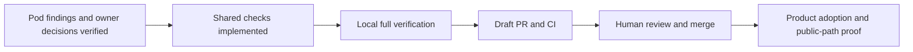

# Funnel implementation timeline

This changes contributor-visible verification order, pre-commit behavior and the shared AGENTS entry point. It does not authorize deployment, change artifact access or replace product gates.

Owner: [.github pod](https://ampcode.com/threads/T-01a1f637-2241-770e-aa29-22cf10bd727e). Task: [RES-67](https://linear.app/resnovas/issue/RES-67), [Resnovas/.github#55](https://github.com/Resnovas/.github/issues/55). Parent: [RES-66](https://linear.app/resnovas/issue/RES-66), [Resnovas/.github#54](https://github.com/Resnovas/.github/issues/54). SMC-175 and SMC-174 are superseded duplicates. Non-closing delivery until full acceptance.

## Completed discovery

- 2026-11-19T23:53Z: verified Eventiva and smartcloud findings; neither enables eslint-plugin-jsdoc. Preserve Eventiva's AST/rationale/zero gate and smartcloud's declaration/example contracts.
- 2026-11-19T23:53Z: GitHub counterparts created after open/closed duplicate searches. The integration assigned RES-66 and RES-67 (subsequently SMC-178) rather than attaching to the existing SMC issues. Mapping decision escalated; no issue deleted or relinked. The first Linear activity comment used an approximate future minute; this timeline records the actual observed tool timestamps.
- 2026-11-20T00:09Z: Jonathan approved ESLint as the minimal shared-config host, corrected AI-03 to prohibit delegated certification except the exact personal-instructions owner exception, and assigned canonical ownership to RES-66/RES-67. The existing author-email DCO check remains in smartcloud CI; its maintainer-warning and trusted-bot rules are unchanged.
- 2026-11-20T00:23Z: verified RES-67 restored to RES under RES-66 with GitHub #55 attached. Exact exception confirmed in loaded personal instructions; TGTGamer/private owner session verified. Updated RES-67 to In Progress for active local verification.

## Implemented contracts

- Shared corrective source-inspection lint and additive JSDoc config; tests exercise rejected/accepted behavior, not deleted-source strings.
- Pre-commit preserves foreign hooks and requires matching staged/working trees, then static and full verification.
- Markdown registry parser, source-inventory comparison, affected selection and byte-bound evidence contracts. No schema result is claimed as semantic proof.
- Fixed document budgets, exact deployed build-info SHA check, static-first reusable CI and seven-day reviewed artifact publication policy.
- Shared AGENTS slimmed while retaining human authority, tracker lifecycle and tool-routing boundaries. Supplied escalation text retained verbatim.

## Delivery and verification

2026-11-20T00:23Z: `npm ci --ignore-scripts` installed the locked toolchain with zero reported vulnerabilities. `node --run verify:static` passed document budgets and six-interface coverage. `node --run verify` passed render, 19 headers, surfaces, generated docs and 103 tests, with measured renderer coverage of 100% lines and 98.58% branches. `node --run verify:evidence` executed all nine documented contracts; `node --run verify:evidence:check` reported structurally valid, byte-bound publication evidence. The installed pre-commit hook is exercised in disposable Git repositories. No downstream runtime, production endpoint or media-redaction review is claimed by these nonvisual contracts.

- 2026-11-20T00:26Z: pushed contracts and the separate graph commit to [draft PR #56](https://github.com/Resnovas/.github/pull/56). Linear automation changed readiness; escalated the integration behavior. The later owner decision below supersedes the original restoration response.
- 2026-11-20T00:28Z: [CI run 44645981211](https://github.com/Resnovas/.github/actions/runs/44645981211) passed Linux/macOS/Windows on Node 24/current. Synthetic affected-contract evidence expires after seven days. Workflow lint and Graphify passed. Dependency review rejected three transitive licences; CodeQL reported hook-write and evidence-read races in canonical/rendered copies. No full-green claim.
- 2026-11-20T00:34Z: local follow-up passed all 103 tests and static gates. Hook installation now creates exclusively without rewriting an existing hook; evidence metadata/digests use one descriptor. All 18 requested JSDoc rules have accepted/rejected real TypeScript fixtures, plus 12 declaration/callback shapes. Semantic accuracy and meaningful in-body rationale remain guidance; downstream AST, zero and example gates are preserved.
- 2026-11-20T00:37Z: MIT-only provenance confirmed for parse-statements@1.0.11 against npm tarball integrity, release LICENSE/package.json and upstream history. Jonathan approved exact-version exceptions for it, spdx-exceptions@2.5.0 and uri-js@4.4.1. Before publication, found that dependency-review-action v5.0.0 ignores versions when matching licence exclusions. Held the policy-only change and requested an owner decision on an exact-version guard versus waiting for an upstream fix; no broadened exception was pushed. Base-ref policy loading stays intact.
- 2026-11-20T00:41Z: added the two subsequently approved rules, sentence-form descriptions and public/exported examples. All 20 rule fixture pairs pass, alongside declaration/callback, export/re-export and private-member controls. Licence exceptions remain held pending the owner's version-guard decision. Eventiva confirms no shared adoption yet; its registry still needs the fenced JSON, blocked/unimplemented and media-duration contracts. Its large-checkout header-inventory buffer/fallback report is a separate shared candidate, not silently included in this change.
- 2026-11-20T00:45Z: Jonathan approved all versions of exactly parse-statements, spdx-exceptions and uri-js, without a version guard. Published [policy PR #57](https://github.com/Resnovas/.github/pull/57), including MIT-only provenance and explicit all-version scope. Local render/check and all 93 base-branch tests passed. Human merge of #57 must precede #56; base-ref licence enforcement stays intact.
- 2026-11-20T00:48Z: confirmed the readiness trigger from [Linear's documentation](https://linear.app/docs/code-and-reviews) and GitHub timelines. #56 requested Copilot at 00:27:12Z and Linear made it ready at 00:27:16Z; #57 repeated at 00:45:49Z/00:45:52Z. Personal settings were not inspected or changed. The later owner decision below supersedes the original response.
- 2026-11-20T00:49Z: policy PR #57 completed CI successfully, including the latest smartcloud aggregate. The #56 follow-up passed local static/full verification (104 tests, zero failures; renderer coverage unchanged). Follow-up delivery and head-specific CI evidence remain on #56; no downstream or production completion is claimed.
- 2026-11-20T00:54Z: follow-up code and graph are pushed to #56 at [afa5fb1](https://github.com/Resnovas/.github/commit/afa5fb16e5b2e222e7067c3738a086b12e448f6c). [CI 44649187620](https://github.com/Resnovas/.github/actions/runs/44649187620) passed all six OS/Node jobs; CodeQL, workflow lint and Graphify passed. CI uploaded affected-funnel-evidence with expiry 2026-11-27. Dependency review still rejects the three packages because #57 is unmerged; smartcloud fails only by aggregating that failure. Both PRs are verified draft. Shared implementation is handed off for human prerequisite review, not running or Done; Eventiva received the exact published adoption contract. Linear updates were verified mirrored to #54 and #55.
- 2026-11-20T01:05Z: Jonathan marked #57 ready and merged it at 01:03:41Z. Resumed RES-67 and removed its obsolete blocked handoff. Local rebase verification passed (104 tests, zero failures), but its lease-protected push refused to overwrite Jonathan's concurrent merge of main into #56. Preserved the unpublished rebase on a backup branch and continued from his [1697fab](https://github.com/Resnovas/.github/commit/1697fab935d1b7271a4e8b81640532980d624f23) without rewriting it. [CI 44650896227](https://github.com/Resnovas/.github/actions/runs/44650896227) passed all six OS/Node jobs; dependency review and smartcloud now pass on the approved policy base. Only refreshed delivery notes and the regenerated graph follow that merge. #56 remains draft; human review and downstream adoption remain outstanding.

- 2026-11-20T01:18Z: Jonathan merged #56 at [6cabf3a](https://github.com/Resnovas/.github/commit/6cabf3afd23652fe1816c81bc1041ab2bf4b000f). [Post-merge CI](https://github.com/Resnovas/.github/actions/runs/44652409049), smartcloud, both CodeQL workflows, workflow lint, Graphify, Scorecard and the automatic release workflow passed. House delivery is merged; downstream adoption remains incomplete.
- 2026-11-20T01:23Z: resumed RES-67 for reported adoption blockers. Eventiva's 3,303,046-byte Git inventory overflows the document checker's default subprocess buffer; generated Linear/Planning regions are incorrectly counted as authored prose. Smartcloud's canonical licence headers conflict with the two prose-contract rules. No product exclusions or gates are relaxed; the separate licence-header inventory fallback is outside this slice.
- 2026-11-20T01:29Z: reproduced ENOBUFS with a real 18,000-entry Git index and reproduced both JSDoc findings on the canonical header before editing. The generated-region control reports 504/400 lines before the fix and no finding after. Targeted fixtures now pass while rejecting authored overflow, malformed/literal markers, noncanonical headers and undocumented declarations. Full verification, a draft follow-up and human acceptance remain the delivery gates.
- 2026-11-20T01:32Z: adoption fixes on `agents/res-67-docs-inventory` pass `node --run verify:static` and `node --run verify`: 104 tests, zero failures, unchanged renderer coverage of 100% lines and 98.58% branches. The inventory is scoped before buffering without a fixed output cap; only balanced generator regions are omitted; two vendor prose rules are delegated with an exact canonical-header exception. No dependency or product exclusion changed. Human readiness/merge and downstream proof remain outstanding; send the accepted merge revision to both product pods after acceptance.
- 2026-11-20T06:26Z: the review host marked [#60](https://github.com/Resnovas/.github/pull/60) ready after substantive review, then requested signed forward reconciliation after [#61](https://github.com/Resnovas/.github/pull/61) landed as [7a404d5](https://github.com/Resnovas/.github/commit/7a404d5f0b5cb2cd8e0147b7ad1c8d3c77cda474). The local merge preserves both Verify templates, their regression/docs, the adoption repairs and all earlier timeline entries. Regenerate LLMS and the clean-source graph instead of choosing one generated branch version. Fresh local/remote gates and review of the delivered head precede protected queue handling by the review host; no force push, policy/settings change or downstream adoption claim.
- 2026-11-20T10:08:24Z: #60 merged under TGTGamer as [db0d996](https://github.com/Resnovas/.github/commit/db0d996da8e7c5e77f4664f0a54de03bd5dfa469). Its tree exactly matches reviewed [d8cd965](https://github.com/Resnovas/.github/commit/d8cd9655c9c3809dc211c21dfd7d7747f244466c), whose local 105 tests, nine evidence contracts and six-lane PR checks passed. Accepted-source handoff sent directly to both product pods. As of 10:12Z, main CI still awaits macOS runners; other main workflows pass. This pod did not merge, and the event establishes neither an owner decision on the separate required-context skip issue nor downstream adoption.
- 2026-11-20T10:12Z: smartcloud's package-local Nx lint exposed a new header-path defect: `context.cwd` made the adapter read a package-local licence template and compare package-relative identity. Root/nested-cwd fixtures reproduce ENOENT before the fix and pass with repository/template identity anchored to the synced module location. Retain canonical/noncanonical, wrong-path/year and declaration controls. Work is active on `agents/res-67-license-root`; full gates and a correction PR precede any accepted-revision claim.
- 2026-11-20T10:14:27Z: #60 main CI completed all six OS/Node lanes, rendered and aggregate check successfully. CodeQL, smartcloud, lint, Scorecard and graph refresh also passed. Merged-main verification is complete, distinct from downstream adoption and the unresolved merge-group policy hold.
- 2026-11-20T11:10:18Z: Jonathan merged the nested-cwd correction [#62](https://github.com/Resnovas/.github/pull/62) as [92bb0b9](https://github.com/Resnovas/.github/commit/92bb0b9d06e95d88395d158e35c5aaf1b9e65004). [Main CI 44725380321](https://github.com/Resnovas/.github/actions/runs/44725380321) passed; accepted-source handoff went directly to smartcloud and Eventiva. Eventiva's isolated 65.4.5 compatibility probe is not full adoption.
- 2026-11-20T11:14Z: Jonathan's relayed decision extends the exact licence-header exemption to every shared JSDoc rule and consuming Node repository. This [house pod](https://ampcode.com/threads/T-01a1f637-2241-770e-aa29-22cf10bd727e) owns the bounded extension on `agents/res-67-jsdoc-headers`. New real-lint fixtures reproduced a consumer-enabled sentence rule proposing to rewrite canonical `@file` text and a tag preference rejecting it. The shared plugin now delegates all vendor rules through the same exact-header adapter, retaining the two existing house aliases. All 20 contract fixture pairs pass with and without headers; rendered Eventiva, smartcloud and unrelated Node fixtures pass root/nested config discovery while rejecting wrong-path headers and missing declaration docs. Full gates and draft PR delivery remain. Leave Linear drafts as they are: no App token or setting change. The merge-group skip question still awaits Jonathan; do not change that workflow.
- 2026-11-20T11:17Z: the all-rule extension passes `node --run verify:static` and `node --run verify`: 106 tests, zero failures, 100% renderer line coverage and 98.57% branch coverage. `verify:evidence` executes all ten registered contracts and `verify:evidence:check` validates byte-bound publication evidence. A separate local audit of all 78 installed vendor rules reports no canonical-header findings with valid rule settings; declaration, invalid-settings and whole-file controls remain active. Generated docs and graph accompany the source delivery. Acceptance, protected landing and downstream adoption remain separate; no readiness token, setting or merge-group workflow changed.
- 2026-11-20T11:24:40Z: the separate all-rule exact-header extension [#63](https://github.com/Resnovas/.github/pull/63) is published, not accepted. Local 106 tests and ten evidence contracts pass; hosted six-lane CI, CodeQL, lint, dependency review and Graphify pass. Linear converted the draft and the unchanged restoration job failed for missing permission; smartcloud aggregates that failure. Leave drafts/settings/tokens unchanged per Jonathan. The extension is not included in the separate policy-only branch.
- 2026-11-20T11:37:18Z: resumed RES-67 for Puck's shared licence-policy rollout request. Regression reproduced the missing exceptions in rendered downstream policy. Move exactly the three all-version exceptions approved in #57 from local house policy into its managed template; retain the licence allowlist and vulnerability/base-ref checks. Document policy-first adoption and reviewed duplicate-local-key migration. No dependency, workflow, access or merge-group-policy change.
- 2026-11-20T11:40Z: the policy-only branch passes static verification and all 106 tests, with renderer coverage of 100% lines and 98.59% branches. The new rendering regression fails before the template change and passes after; it proves the exact package scope, preserved licence allowlist, duplicate-key rejection, unrelated local policy preservation and idempotent migration. Human acceptance and downstream policy-first rollout remain pending; this is not JSDoc adoption evidence.

## Remaining acceptance

1. Obtain acceptance of shared policy #64 after fresh checks on the accepted #63 base. Land policy in consuming repositories before dependency adoption. The header extension and queue/readiness correction are accepted; runtime aggregation and queued-SHA proof remain separate gates.
2. Re-run downstream discovered-config and document-budget checks against the accepted revision. Eventiva's unmarked over-budget documents remain downstream remediation, not exemption candidates; no JSDoc installation or complete adoption is claimed there.
3. Product pods adopt the tested shared contracts via normal house sync; preserve their trust gates, coverage and documentation ratchets. Verify affected runtime/native paths in those repositories. A synced config is not proof of adoption.
4. RES-67 and RES-66 remain non-closing until whole-issue acceptance. Do not remove the personal documentation paragraph until downstream adoption is verified; the remaining semantic guidance now lives in shared AGENTS and the canonical guide.

## EVE-261 process-lifetime follow-up

- 2026-11-20T13:55:16Z: PR59 merged normally as [d6daf4a](https://github.com/Resnovas/.github/commit/d6daf4af54bf195915d14ac04706aa5ea4ba3152), following fully green sourcecd1dc80. Scoped Eventiva sync exposed missing explicit `close` evidence required by its newer telemetry contracts. Puck authorized this owner's narrow canonical follow-up: emit at the actual close callback, allow safe nested forwarding and extend existing normal/no-fd3/journal/cancel/deadline matrix proofs, without lifetime or budget changes. Three focused cases fail before; local process21/21 and static checks pass after. Full hooks, exact-head hosted matrix, normal merge and downstream resync remain separate gates; EVE-261/Core stays open.

- 2026-11-20T06:30Z: [replacement owner](https://ampcode.com/threads/T-5dcbf3b4-41e4-4df0-906d-93629eebe199) reproduced the [PR59](https://github.com/Resnovas/.github/pull/59) descendant defect against `ed465c31`: deadline 154 ms, direct exit 156 ms, actual close 1868 ms for a 150 ms budget. Five additional real resistant-descendant contracts fail on that baseline: deadline, cancellation, abort, leader exit with inherited pipes and leader exit with ignored pipes. Independent PID teardown bounds failed proofs.
- Local POSIX group ownership passes all 16 process contracts, preserving actual exit status 23 for natural leader exit, descriptor/IPC close and 100 ms escalation even after leader close. A further red/green regression retains AbortSignal cancellation during post-close escalation. Published main `7a404d5f` is reconciled without overwriting Verify mirrors. No existing budget, assertion, matrix, dependency or coverage gate changes. These measurements establish correctness, not an optimization speedup. Full static/verification and fresh matrix evidence are required on the delivered head.
- 2026-11-20T06:40Z: [matrix44689185354](https://github.com/Resnovas/.github/actions/runs/44689185354) on `344fc81` passed all 121 tests on Linux/macOS Node24/current. Both Windows versions passed Node-parent deadline/cancel/abort/exited-root/ignored-pipe cases; only the new post-completion cancel-phase expectation failed. This supersedes the initial blanket Windows defect assumption. Node's existing libuv Job explains that narrower success but explicitly permits subprocess breakaway. Correct the lifecycle expectation without weakening resource/exit assertions; qualify native shell roots separately. Exited-root taskkill returned128/root not found on both Windows versions.
- 2026-11-20T06:49:59Z: [head ece7e01](https://github.com/Resnovas/.github/commit/ece7e01d769a1f6ddf5379b89ac33377ddfa9efb) completes [matrix44690394556](https://github.com/Resnovas/.github/actions/runs/44690394556). `npm test` passes124/124 on Ubuntu Node24.22.3/current27.0.0-alpha.0.1.1 and macOS Node24.22.2/current27.0.0-alpha.0.1.1. Native deadline/cancel/exited-root totals are1104/21/129 ms and1104/25/129 ms on Ubuntu,1107/43/184 ms and1107/31/152 ms on macOS; descendant death and natural status23/null signal pass. Local static-first full verification and installed hooks pass124/124, coverage100.00% lines/98.57% branches/100.00% functions; graph check matches. No speedup is claimed.
- Both [Windows24.22.3](https://github.com/Resnovas/.github/actions/runs/44690394556/job/136134583554) and [Windows current27.0.0-alpha.0.1.1](https://github.com/Resnovas/.github/actions/runs/44690394556/job/136134583523) pass121/124, failing only the three native-root cases. For budget1000 ms, deadline/root-exit occur at1006/1008 ms and1007/1009 ms, but actual close waits until independent teardown at1559/1573 ms. Cancel/root-exit occur at54/56 ms and59/61 ms; close waits for teardown at757/764 ms. Natural root exit at56/69 ms still leaves pipes open until teardown at811/833 ms; `taskkill /T /F` returns128/root not found. Native readiness and canary output precede each failure. All Node-root descendant cases, including corrected post-completion abort, pass. These retained red regressions require an approved Windows native ownership boundary, not a larger budget, reader destruction or early resolution. No such supervisor/Job/dependency is added; PR59 remains blocked and draft.
- Readiness restoration fails because its integration cannot call `convertPullRequestToDraft`; owner-authorized CLI restores and verifies draft. No permissions/workflow change is included. Two [CodeQL comments](https://github.com/Resnovas/.github/pull/59#discussion_r4639368911) flag command/environment flows at the generic spawn boundary; detailed alert reads return403. They remain untriaged, not dismissed or claimed safe. Graphify Cloud memory is unavailable; local graph and preserved real-process logs provide evidence instead.
- No new native Job/supervisor boundary is adopted. PR59 stays draft; [EVE-261](https://linear.app/resnovas/issue/EVE-261) / [Eventiva#1035](https://github.com/Resnovas/Eventiva/issues/1035) remain non-closing. Eventiva migration is held for a corrected house merge plus normal sync. Other Core work and separately investigated telemetry deadlines are not attributed to this defect.
- 2026-11-20T11:45Z: Jonathan's ready transition supersedes the earlier draft state. Puck relayed authorization to reconcile PR59 with current house main `92bb0b9d` by normal merge, without rewriting history, then merge normally only after the Windows decision and green checks. Only the generated graph conflicted; regenerate it from both source histories. Local static-first verification passes 124/124 with 100% line and 98.57% branch renderer coverage. The three native Windows ownership regressions remain unchanged and unresolved; no supervisor, skip, protection bypass, queue action or Eventiva adoption is authorized by this reconciliation. Fresh exact-head hosted checks are still required.
- 2026-11-20, exact decision time unknown: Puck relayed Jonathan's binding choice B in the [owning thread](https://ampcode.com/threads/T-5dcbf3b4-41e4-4df0-906d-93629eebe199). Windows rejects roots other than `process.execPath` before spawn with typed actionable error; Linux/macOS retain native roots. The three Windows native lifetime cases now prove refusal, zero spawn calls and error guidance, also exercised with a simulated Windows platform on POSIX. All real Node-root tests and POSIX native lifetime assertions remain; no budget, coverage, dependency or protection changes. Local focused process tests pass19/19; static checks pass. Full local and hosted matrix verification remain required before normal merge and downstream sync. Timing-fix delivery in Eventiva is already published separately; renewal qualification remains its owner's lane. EVE-261/Eventiva#1035 remain open.
- 2026-11-20T12:45Z: Choice B source `c1737af` passes local static-first full verification124/124 and the normal installed hook, coverage100% lines/functions and98.57% branches. The first hook attempt failed the unchanged150 ms descendant probe because stdout had no PID marker by its deadline; its isolated rerun produced output46 ms/deadline156/close257 and passed. The second normal hook passed without edits, increased budgets or assertion changes. Retain that failure as unresolved scheduling-sensitive evidence, not a claimed fix or causal diagnosis. An in-memory guard-removal control reached the mocked spawn; the fixed owner made zero calls with the expected typed error. No actual child was launched in that negative control. Hosted matrix remains pending.
- 2026-11-20, after12:53Z: Puck rejects passing-retry acceptance and approves separating the150 ms expiry/actual-close regression from the six existing1000 ms ready/PID/death scenarios, unchanged on all OS lanes. Two finite CPU loops plus eight-child cohorts reproduce21/24 missing PID markers while24/24 expire/close in254-325 ms; fresh loaded corrected suite passes7/7. [Shell/deadline evidence](test-process-security.md) records scope, invalid-probe exclusion and caller audit. Head6a9d3fe's four POSIX lanes pass124/124; both Windows lanes fail only the old missing-executable ENOENT fixture. Correct it to supported Node with missing cwd, retaining1000 ms and OS error assertion. Explicit shell:false plus runtime/type rejection and literal argv/space-path proofs are local; focused21/21 and static checks pass. Full hooks and fresh matrix remain pending. Alerts64/65 remain human-triage blockers; no merge, bypass or Eventiva adoption.
- 2026-11-20, exact authorization time unknown: Jonathan explicitly overrides AI-21 and AI-31 for Resnovas/.github and Eventiva, as relayed by Puck in the owning thread: agents may mark ready and merge only with all required checks green, branch protection intact and no bypass. PR59 still requires the shell proof, resolved alerts64/65 and full green matrix. Corrected local static-first verification passes126/126, unchanged100% line/function and98.57% branch coverage; strict declaration positive and four shell-negative compiler cases pass. These local results do not authorize a red-head merge.

## Current queue and readiness decision

2026-11-20T12:45:30Z: resumed RES-67 on `agents/res-67-merge-group-check` for Jonathan's decision to execute smartcloud on merge-group commits. The later instruction removes Linear draft restoration completely, including its workflow, templates and fixtures, without replacement, token or setting changes. Agents let Linear transitions stand. The exact later decision time is unavailable; both decisions were delivered through the owner coordination thread to this pod.

The shared queue contract executes its own workflow body against accepted/rejected synthetic workflow inputs. The pre-render regression failed on the old skipped job. At 2026-11-20T12:53:44Z, `node --test test/actions.test.mjs test/workflows.test.mjs` passes 20 tests; `node --run verify:static` and `node --run verify` pass 105 tests with zero failures, 100% renderer lines and 98.57% branches. Actionlint passes, and offline zizmor reports no findings (one ignored, six suppressed by the existing configuration). The existing action-key test initially treated the embedded literal pattern as a YAML key; the contract now reads the step key/value explicitly, without changing that test. Publication, hosted checks and human acceptance remain pending. No review, merge or queue admission is performed by this pod.

Two acceptance limits remain explicit: the inspected `smartcloud@v2` at `2d5c398d536664a22b473e9126491305a1c0e96e` decodes merge-group SHA but its required-check feature handles only pull requests; its owning pod must correct and release that runtime. Also, its sync planner only creates or updates current template paths: deleting a template does not delete a previously synced downstream file. Existing consumers must remove `.github/workflows/house-readiness.yml` in their normal PRs. Do not claim propagation from template deletion alone. The queue review host requires actual execution on the queued SHA after acceptance, with the existing required matrix and post-merge evidence.

2026-11-20T12:57:45Z: Jonathan merged [#65](https://github.com/Resnovas/.github/pull/65) as [cf50bdf](https://github.com/Resnovas/.github/commit/cf50bdfdf779b1e851c63d0461086fc93ac41612). Its [PR CI 44739870574](https://github.com/Resnovas/.github/actions/runs/44739870574) passed all six OS/Node lanes, aggregate `check`, the shared queue contract and retained checks; the old base restoration job's permission failure kept that head's smartcloud aggregate red. The PR was created draft and Linear converted it without manual reversal. The delivery-note-only push raced with the merge and remains preserved on its branch; this entry carries its evidence forward. Both product pods received explicit downstream-deletion handoffs. The queue review host received the accepted revision without a hold-clearance claim. At 12:59:17Z, [main CI 44740148884](https://github.com/Resnovas/.github/actions/runs/44740148884) and all seven other main workflows have passed. Fresh #63/#64 heads are the active verification work requested by Jonathan: forward reconciliation preserves published commits and the runtime/queued-SHA hold. The #63 reconciliation passes static/full gates (106 tests, zero failures) and ten evidence contracts locally; exact-head hosted verification remains pending publication.

2026-11-20T13:08:29Z: Jonathan merged [#63](https://github.com/Resnovas/.github/pull/63) as [ba54e5f](https://github.com/Resnovas/.github/commit/ba54e5f3894aa3e9c1f69200b1d408480c5457de). Accepted head [3931d2d](https://github.com/Resnovas/.github/commit/3931d2d23d09bb6f1c929b0e7271822172d51fe9) passed six-lane CI, smartcloud and required aggregation; only Cursor's advisory security review remained pending. Both product pods received the accepted header revision. #64's first refreshed head [8122cc6](https://github.com/Resnovas/.github/commit/8122cc66da9dbefdd0b869498cd77eabc03c1515) passed all checks in [CI 44741035280](https://github.com/Resnovas/.github/actions/runs/44741035280) and the retained workflows, but the new main created a timeline conflict. Reconcile again, preserve both slices and the policy boundary, and run fresh local/hosted gates. The combined workflow guide was condensed after its unchanged byte budget caught the merged additions. No queue-hold clearance or downstream adoption is claimed.

Following Jonathan's later explicit rebase/draft instruction (receipt time not recorded), #64 is rebased onto accepted #63 with the old head preserved locally. All eight main workflows, including [six-lane CI 44741702576](https://github.com/Resnovas/.github/actions/runs/44741702576), passed on `ba54e5f`. The combined policy source passes static/full verification: 107 tests, zero failures, 100% renderer lines and 98.59% branches. Its regression retains exactly `parse-statements`, `spdx-exceptions` and `uri-js`; accepted header and queue changes remain intact. #64 stays draft pending fresh exact-head hosted results and acceptance. The queue hold still requires the runtime release and actual queued-SHA proof.
