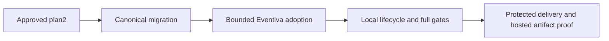

# Graphify migration timeline

Owner: [implementation thread](https://ampcode.com/threads/T-01a21be5-639d-7648-a3d5-d9b54cf795e2). Approved [plan revision 2](https://ampcode.com/artifacts/eventiva-graph-generation-378f45fd-4d09-4849-8f38-1949db89f302). Verified mappings: [RES-74](https://linear.app/resnovas/issue/RES-74) / [Resnovas/.github#87](https://github.com/Resnovas/.github/issues/87) and [EVE-305](https://linear.app/resnovas/issue/EVE-305) / [Resnovas/Eventiva#1108](https://github.com/Resnovas/Eventiva/issues/1108).

| State | Evidence and next step |
| --- | --- |
| Completed intake, 2026-11-27 | Exact initial start unknown; RES-74 tracker start 07:28:30Z. Separate worktrees preserve other work. Read plan2 and verified integration attachments. Duplicate tracker intake records are not separate owners. |
| Completed cache preservation | Forty-three tracked semantic JSON files parsed and checksum-verified against backup before index removal. Originals remain ignored locally. Configuration stays tracked. |
| Current implementation | Canonical local lifecycle, fingerprints, atomic replacement, post-event hooks and per-read MCP refresh. The commit-msg guard rejects manual generated output; only daily/manual main automation proposes signed updates to separate tracked snapshots. No generation in PR workflows or freshness gate. Legacy reusable workflow remains for other live callers; no other repository is migrated. |
| Current settings evidence | Ruleset24073109 requires smartcloud/check; Eventiva27203425 requires smartcloud/house check/application check. Neither names Graphify. Classic branch-protection reads403 in both repositories; owner must inspect those before declaring no settings work. No settings changed. |
| Verified local checkpoint | `npm run verify`: 158/158 tests, 100% instrumented lines and 95.30% branches; `node --run verify:static`: budgets/registry pass. Real Graphify0.9.121 fixture passes setup, dirty edits/deletions/renames, checkout/commit/merge, two feature/fix branches, ordinary/rebase pulls, long-lived MCP reload and provenance. Synthetic controller tests cover concurrent refresh, failed-generation retention, cache/hook preservation and tracked-output rejection. Canonical task-owned Eventiva sync checks 30 paths with zero drift. |
| Eventiva blockage | Its native-hook suite passes11/11, but root `check` reports two missing-jsdoc findings at unchanged `tools/test-process/process.d.mts:76`. `git show HEAD:...` compares byte-identical and independent inspection of that source reproduces both; no ratchet exemption or unrelated edit. Full acceptance remains blocked. |
| Blocked handoff, 2026-11-27T07:44:48Z | Both migrations remain uncommitted/unpushed in isolated workspaces. Eventiva `verify:static` passes; full `verify` stopped at licence checking because a temporary fixture was inside the scan. The fixture was preserved outside that scan, then all 339 source licence headers passed and the baseline documentation blocker reproduced. No full-pass claim. The process owner has not accepted this defect. Preserve patches, untracked sources and logs under the implementation thread's `.amp/in/orb-backup/graphify-migration/`. |
| Resumed, 2026-11-27T09:04:47Z | Jonathan supersedes artifact-only publication with workflow-owned graph commits and requires PR delivery without waiting for the separately owned baseline defect. Existing protections require signed PRs and checks, so publication uses a dedicated automation PR branch, never direct main or feature/fix branches. The exact permitted message exists only in workflow configuration; hook context is not authentication. The guard regression fails before the fix and passes after; focused20/20 and house159/159 pass. Workflow actionlint1.7.12 and zizmor1.30.1 pass. Latest Eventiva main includes the other owner's declaration repair; this lane did not edit it. |
| Local verification, 2026-11-27T09:14:43Z | Final house `node --run verify` passes159/159 with100% instrumented lines and95.30% branches; static verification passes. The commit hook exposed a missing affected-test owner for rendered smartcloud configuration; mapping it to existing rendering/policy tests fixes the rejection without bypass. Repeated real lifecycle passes through pull/rebase and MCP. Canonical Eventiva sync checks31 paths with zero drift; its full disposable-PostgreSQL verification is still running. |
| House delivery, 2026-11-27T09:28:17Z | [PR88](https://github.com/Resnovas/.github/pull/88) implementation head7a423ac has successful required check/smartcloud and completed Linux/macOS/Windows, workflow-lint and CodeQL verification. Opened as a disclosed draft; automation changed it to non-draft. No merge, automatic-merge request or hosted publication. Subsequent documentation-only evidence does not inherit that exact-head CI result. |
| Eventiva admission blocked, 2026-11-27T09:34:52Z | The separately owned declaration repair is in main9c669cf1. Full verification first failed two telemetry child deadlines, whose isolated rerun passed9/9. The next full run failed two unchanged server tests with EADDRINUSE at127.0.0.1:34574. The ordinary signed commit then failed the installed static-plus-affected hook on three server tests with that same reported port. No timeout, assertion, concurrency setting or hook was bypassed. Eventiva remains staged, uncommitted and unpushed; no integration PR exists. Root/static, resource/native143/143 and canonical sync31/31 pass, but full acceptance and later smoke/features stages remain unverified. |
| Current handoff | Preserve the Eventiva patch, index evidence and logs in the implementation thread backup. A server-test owner must resolve or qualify the listener conflict before the normal commit gate can admit this integration; assignment is not confirmed. Keep RES-74 and EVE-305 open and preserve automatic tracker readiness. Administrator inspection of classic protection, Actions access/retention and existing App contents/PR-write permission remains required because those reads return403. No settings or additional repositories changed. |
| Upcoming | Deliver disclosed draft implementation PRs with exact-head CI and honest remaining failures, then verify hosted daily/manual publication. Merge the canonical reusable workflow before adopting the Eventiva caller. The caller requires the existing repository App credentials with contents/PR write permission; its workflow token stays read-only. No settings changes or whole-issue closure before acceptance. |

The [migration guide](graphify.md) owns branch/cache preservation and lifecycle commands. Graphify Cloud is unavailable; no memory write is claimed. Linear checkpoint read back at [house](https://github.com/Resnovas/.github/issues/87#issuecomment-7212638017) and [Eventiva](https://github.com/Resnovas/Eventiva/issues/1108#issuecomment-7212638146). Actions-settings reads also return403. This checkpoint records local proof, not hosted publication or deployment.
